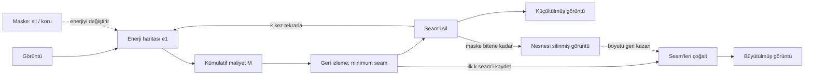
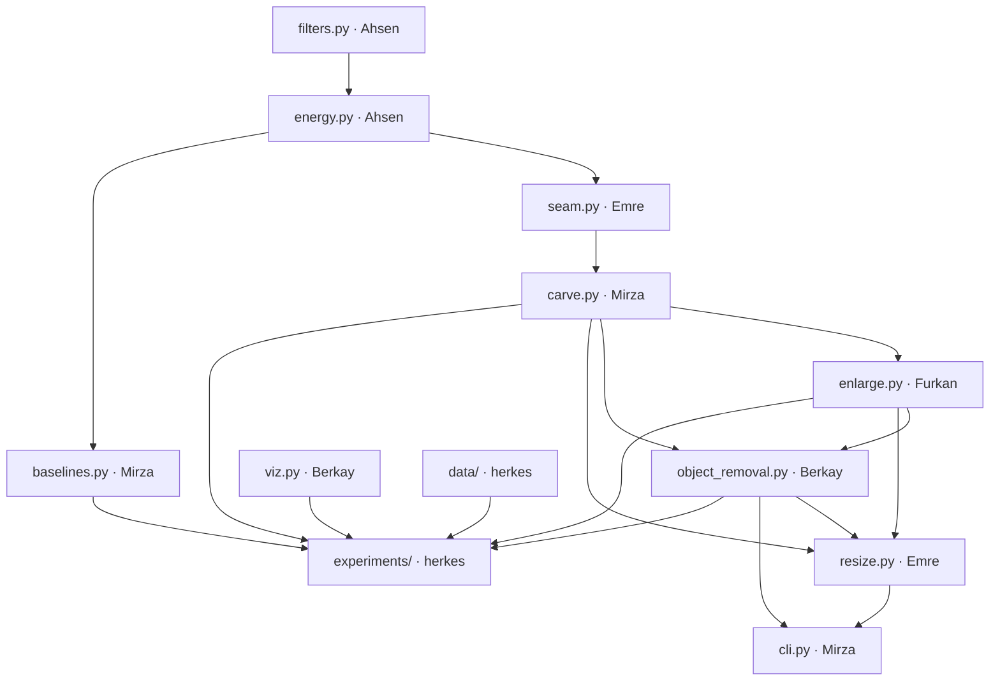

# Seam Carving — Proje Haritası

**INF605 Fundamentals of Image Processing · Güz 2026 · Final projesi**

Makale: S. Avidan ve A. Shamir, "Seam carving for content-aware image resizing", *ACM Trans. Graph.*, 26(3), 2007.

Sürüm v2 · 19 Kasım 2026. v2'de iş, beş paralel Claude oturumuyla tek seferde bitecek şekilde yeniden bölündü (Bölüm 6–7); kişi başı görevler `gorevler/` klasöründe. Teslim listesi ve rapor dili varsayımdır (Bölüm 14).

## 0. Bir bakışta

- **Ne yapıyoruz:** Makaledeki seam carving yöntemini NumPy ile kendimiz yazıyoruz. Zincir: enerji haritası → dinamik programlama ile minimum seam → küçültme → büyütme → maske ile nesne silme.
- **Neyle kıyaslıyoruz:** `cv2.resize` (ölçekleme) ve kırpma. Veri: kendi çektiğimiz fotoğraflar.
- **Dersle bağı:** Hafta 5, "Sharpening spatial filters". Makalenin enerji fonksiyonu, slayttaki gradyan büyüklüğü yaklaşımı `|gx| + |gy|` ile aynı ifadedir.
- **Ekip:** 5 kişi. Herkes bir çekirdek modülün, en az bir deneyin, rapor bölümlerinin ve bir birleştirme görevinin sahibi.
- **Çalışma düzeni:** beş paralel oturum, üç dalga (Bölüm 7). Görev dosyaları: `gorevler/emre.md`, `ahsen.md`, `mirza.md`, `furkan.md`, `berkay.md`.
- **Bugünkü durum:** Depo boş; 5 kişi de yazma yetkisiyle ekli.

> **Seam nedir?** Görüntüyü yukarıdan aşağıya (dikey seam) ya da soldan sağa (yatay seam) kat eden, her satırda (sütunda) tam bir piksel içeren ve ardışık pikselleri birbirine komşu olan yol. Dikey bir seam silinince görüntü bir sütun daralır; silinen pikseller her satırda farklı sütundan seçilebildiği için önemli içerik yerinde kalır.

## 1. Proje kimliği

| Alan | Değer |
|---|---|
| Ders | INF605 Fundamentals of Image Processing, Dr. Batuhan Hangün, Türk-Alman Üniversitesi, Güz 2026 |
| Makale | Avidan & Shamir 2007, doi:10.1145/1276377.1276390 |
| Uygulanacaklar | Energy map, minimum seams with dynamic programming, shrinking and enlarging, object removal with a mask |
| İlgili ders konusu | Sharpening spatial filters (image gradient), Hafta 5 |
| Veri | Kendi fotoğraflarımız |
| Hazır model | Yok; kıyas `cv2.resize` ve kırpma ile |
| Depo | https://github.com/aemref/Seam-carving-Avidan-Shamir-2007- (public) |
| Ekip | Emre (`aemref`), Ahsen (`ahsenayvaz`), Berkay (`berkayaysel`), Mirza (`Marzi77`?), Furkan (`Freigeist3`?) |
| Araçlar | Python 3.11+, NumPy, OpenCV (dosya okuma/yazma, kıyas ve test referansı), Matplotlib, pytest |

## 2. Kapsam

| Öncelik | Özellik | Makalede | Not |
|---|---|---|---|
| Zorunlu | Enerji haritası (e1) | §3, Denk. 1 | Teklif formunda söz verildi |
| Zorunlu | DP ile minimum seam, dikey ve yatay | §3, Denk. 2–4 | |
| Zorunlu | Küçültme (seam silme) | §4.1 | |
| Zorunlu | Büyütme (seam ekleme) | §4.3 | |
| Zorunlu | Maske ile nesne silme | §4.6 | |
| Zorunlu | `cv2.resize` ve kırpma ile kıyas | Şekil 5 | Makale de aynı üçlüyü kıyaslıyor |
| Hedef | Koruma maskesi | Şekil 11 | Nesne silmeyle aynı mekanizma |
| Hedef | Nesne silindikten sonra orijinal boyuta dönme | Şekil 12 | Büyütme modülünü kullanır |
| Hedef | %50'den fazla büyütmede kademeli ekleme | §4.3, Şekil 8 | |
| Hedef | Enerji operatörü karşılaştırması | §3.2 | Ders bağını güçlendirir |
| Hedef | Enerji korunumu eğrisi; sütun silme ve en iyi kırpma kıyasları | §3.1, Şekil 2–3 | Makaledeki bir sonucu yeniden üretmek |
| Hedef | İçerik büyütme (content amplification) | §4.4 | Var olan parçalarla birkaç satır |
| Hedef | Süre ölçümü, başarısızlık örnekleri, gürültü deneyi | §5, §6 | |
| Zaman kalırsa | Optimal seam sırası (transport map) | §4.2, Denk. 6 | Pahalı; küçük görüntüde denenir |
| Zaman kalırsa | Çok boyutlu görüntü (indeks haritası V) | §5 | İndeks haritasını zaten tutuyoruz |
| Zaman kalırsa | eHoG enerjisi, Numba ile hızlandırma, canlı demo arayüzü | §3.2 | |
| Kapsam dışı | Gradyan uzayında seam carving (Poisson çözücü) | §4.5 | |
| Kapsam dışı | Video, forward energy, yüz dedektörü, öğrenme tabanlı yöntemler | — | Başka makalelerin konusu |

Kural: "Zaman kalırsa" satırlarına, zorunlu ve hedef satırları bitmeden başlanmaz.

## 3. Algoritma haritası



### Ortak kurallar

| Nesne | Gösterim |
|---|---|
| Görüntü | `np.ndarray`, `(H, W, 3)`, `uint8`, BGR (`cv2.imread` çıktısı) |
| Enerji | `(H, W)`, `float64` |
| Dikey seam | `(H,)` tamsayı dizi; `seam[r]` = r. satırda seçilen sütun |
| Maske | `(H, W)`, `bool` |
| İndeksleme | `img[r, c]`: önce satır, sonra sütun (Hafta 3, slayt 13–14) |

- Yatay seam için ayrı kod yazılmaz: görüntü transpoze edilir, dikey fonksiyon çağrılır, sonuç geri çevrilir.
- Fonksiyonlar girdilerini değiştirmez, yeni dizi döndürür.
- Hesap `float64` ile yapılır; kaydetmeden önce `np.clip(..., 0, 255).astype(np.uint8)` (slaytlardaki kalıp).
- Kodda `x`/`y` adı kullanılmaz: ders kitabında x satırdır, makalede ve OpenCV'de x sütundur. `r`/`c` ve `d_rows`/`d_cols` kullanılır.

### 3.1 Enerji haritası (`filters.py`, `energy.py`)

```
e1(I) = |∂I/∂x| + |∂I/∂y|                      (makale, Denk. 1)
```

Düşük enerji, çevresine karışan ve silinince fark edilmeyecek piksel demektir. Bu ifade Hafta 5, slayt 56'daki `M(x, y) ≈ |gx| + |gy|` yaklaşımının kendisidir; karekök alınan hali makalenin de denediği L2 sürümüdür (§3.2).

- **Türev operatörleri:** ileri fark (slayt 43), Roberts ve Sobel (slayt 57), Scharr. Karşı örnek olarak Laplacian (ikinci türev, slayt 47–48). Varsayılanı D1 deneyi belirler; başlangıç Sobel.
- **Sıfırdan yazım:** Türev, kendi `correlate2d` fonksiyonumuzla alınır (slayt 5–12'deki "sum of products"). `cv2.Sobel` ve `cv2.filter2D` yalnızca testte referanstır.
- **Renk:** gri tonda hesap ya da üç kanalda hesaplayıp toplama; ikisi de parametre, D1'de karşılaştırılır.
- **Dolgu (slayt 33):** yansıtma ya da kopyalama. Sıfır dolgu görüntü kenarında sahte kenar üretir ve seam'ler kenar sütunlarından kaçar. Karşılıklar: `np.pad` `reflect` = `cv2.BORDER_REFLECT_101` (cv2 varsayılanı), `symmetric` = `BORDER_REFLECT`, `edge` = `BORDER_REPLICATE`.
- **Veri tipi:** `uint8` üzerinde çıkarma taşar (200 − 250 = 206). Önce `float64`.
- **Gösterim:** enerji haritası kaydedilirken min-max ile [0, 255]'e gerilir (Hafta 6, slayt 13–14); çok parlak birkaç kenar görüntüyü karartıyorsa log dönüşümü (slayt 8).
- **Bitti ölçütü:** Sobel sonucumuz aynı dolguyla `cv2.Sobel` çıktısına 1e-9 hassasiyetle eşit; düz renkli görüntüde enerji her yerde 0; tek dikey kenarlı yapay görüntüde yalnızca kenar sütunları sıfırdan farklı.

### 3.2 Minimum seam (`seam.py`)

```
dikey seam:  her satırda tek piksel, |x(i) − x(i−1)| ≤ 1          (Denk. 2)
maliyet:     E(s) = Σ e(I(s_i)),  aranan s* = en küçük E(s)        (Denk. 4)
DP:          M(i, j) = e(i, j) + min( M(i−1, j−1), M(i−1, j), M(i−1, j+1) )
```

İlk satırda `M = e`. Son satırdaki en küçük değer seam'in bittiği yerdir; oradan yukarı doğru geri izlenir. Komşuluk koşulu, seam'in 8-bağlantılı bir yol olması demektir (Hafta 3, slayt 38–40).

- **Hız:** Satır içi işlem vektörleştirilir, Python döngüsü yalnızca satırlar üzerinde döner. Ön ölçüm (proje kodu değil, atılacak bir deneme betiği; Apple M4, NumPy 2.3, tek kanal, yapay görüntü):

  | Görüntü | Seam başına süre | Genişliği %25 daraltma |
  |---|---|---|
  | 400 × 600 | 12 ms | 150 seam ≈ 2 sn |
  | 533 × 800 | 21 ms | 200 seam ≈ 4 sn |
  | 683 × 1024 | 35 ms | 256 seam ≈ 9 sn |
  | 1067 × 1600 | 79 ms | 400 seam ≈ 32 sn |

  Aynı DP iç içe iki Python döngüsüyle yazılınca 533 × 800'de tek seam 395 ms sürüyor (vektörleştirilmiş hali 16 ms). Renkli görüntüde enerji ve silme adımı biraz uzar. Sonuç: uzun kenarı 800 piksel olan çalışma boyutu NumPy ile rahat.
- **Tuzaklar:**
  - İlk ve son sütunda bir komşu eksiktir; `+inf` ile doldurulur.
  - Geri işaretçileri `int8` tutuluyorsa indekse eklerken `int(...)` ile çevrilir. NumPy 2'de `167 + np.int8(1)` taşma hatası verir (ön ölçümde karşılaşıldı).
  - Eşitlikte `argmin` en soldakini seçer; sonuç deterministiktir.
  - Her satırda en küçük komşuya giden açgözlü yöntem optimal değildir. Raporda küçük bir karşı örnekle gösterilir.
- **Bitti ölçütü:** En çok 6 × 6 boyutlu rastgele enerji haritalarında tüm geçerli seam'ler tek tek denenir (W · 3^(H−1) aday) ve en küçük maliyet DP sonucuna eşit çıkar; dönen seam komşuluk koşulunu sağlar; `seam_cost` değeri `M`'nin son satır minimumuna eşittir.

### 3.3 Küçültme (`carve.py`)

Genişliği c piksel azaltmak için c dikey seam art arda silinir (§4.1). Her adım: enerji → seam → sil.

- **Silme:** `(H, W)` boyutlu bir `bool` maske ile seam dışındaki pikseller alınır, `(H, W−1, C)` olarak yeniden şekillendirilir. Aynı fonksiyon `(H, W)` dizilerde de çalışır.
- **Birlikte kesilen diziler:** Maskeler ve indeks haritası her adımda aynı seam ile kesilir. Biri unutulursa görüntü ile maske kayar.
- **İndeks haritası:** Başlangıçta `idx[r, c] = c`. Silinen seam'in orijinal sütunları, silmeden hemen önceki `idx[r, seam[r]]` değerleridir. Bu harita üç işe yarar: tüm seam'leri orijinal görüntü üzerinde çizmek (makale Şekil 1), büyütme (3.4) ve çok boyutlu görüntü (§5).
- **Enerji** her silmeden sonra yeniden hesaplanır; komşuluklar değişmiştir.
- **İki boyut:** önce genişlik sonra yükseklik ya da dönüşümlü. Optimal sıra (§4.2) "zaman kalırsa" listesinde.
- **Bitti ölçütü:** çıktı boyutu doğru; 0 seam silmek görüntüyü değiştirmiyor; düz arka plan üzerinde yüksek enerjili kare içeren yapay görüntüde, arka plan tükenene kadar kare bozulmuyor.

### 3.4 Büyütme (`enlarge.py`)

- **Yanlış yol:** en iyi seam'i bul, çoğalt, tekrarla. Aynı seam yeniden seçilir ve görüntüde gerilmiş bir şerit oluşur (Şekil 8b). Bu sürümü bilerek üretip D4'te gösteriyoruz.
- **Doğru yol (§4.3):** Görüntünün kopyasında silinecek ilk k seam bulunur, indeks haritasıyla orijinal koordinatlara çevrilir ve hepsi orijinal görüntüde çoğaltılır. Yeni piksel, seam pikseli ile komşusunun ortalamasıdır.
- **Uygulama ipucu:** k seam, her satırında tam k tane `True` olan `(H, W)` boyutlu bir haritada toplanır. Çıktı `np.repeat` ile kurulur (seçili pikseller ikişer kez), sonra eklenen kopyalar komşu ortalamasıyla değiştirilir.
- **%50 üstü:** işlem adımlara bölünür; her adım o anki genişliğin en çok yarısı kadar ekler (§4.3).
- **İçerik büyütme (§4.4):** `cv2.resize` ile büyüt, seam silerek eski boyuta dön.
- **Bitti ölçütü:** çıktı `(H, W + k)`; eklenen pikseller çıkarılınca orijinal görüntü birebir geri geliyor; düz renkli görüntü düz kalıyor.

### 3.5 Maske ile nesne silme (`object_removal.py`, `tools/mask_painter.py`)

Kullanıcı silinecek bölgeyi işaretler; işaretli piksel kalmayana kadar seam silinir (§4.6, Şekil 11–12).

- **Mekanizma:** Enerji hesaplandıktan sonra silme maskesindeki piksellere büyük negatif, koruma maskesindekilere büyük pozitif değer yazılır.
- **Ağırlık:** Sabit sayı yerine enerji haritasından türetilir. Silme `−R`, `R > 2 × H × max|e|`: maskeden bir piksel fazla geçmek her zaman kazançtır. Koruma `+P`, `P > H × (R + max|e|)`: tek bir korunan piksel, maskenin tamamından geçmenin kazancından pahalıdır. Çakışmada koruma kazanır.
- **Yön:** Dikey silmede gereken seam sayısı, maskenin en kalabalık satırındaki piksel sayısıdır; yatayda en kalabalık sütunundaki. Küçük olan yön seçilir (makaledeki "smaller diameter").
- **Boyutu geri kazanma:** silinen seam sayısı kadar seam eklenir (3.4). Bu yüzden modül `enlarge.py`'ye bağlıdır.
- **Maske üretimi:** `mask_painter.py` fareyle boyama aracı: sol tuş silme, sağ tuş koruma; iki ayrı PNG kaydeder. Herhangi bir resim düzenleyicide çizilen siyah-beyaz PNG de olur.
- **Tuzaklar:**
  - Maske yeniden boyutlandırılacaksa en yakın komşu kullanılır (Hafta 3, slayt 47, soru 6). Bilineer ara değer üretir.
  - Nesnenin gölgesi ve kenar halesi maskede yoksa geride kalır. Maske birkaç piksel genişletilir; `cv2.dilate` Hafta 6, slayt 46'daki max filtresidir.
  - Döngüye üst sınır konur (en çok W adım); maske bir sebeple bitmezse sonsuz döngü olmaz.
- **Bitti ölçütü:** maske beklenen sayıda seam ile bitiyor; korunan piksellerin hepsi çıktıda duruyor; boyut geri kazanma açıkken çıktı boyutu girdiye eşit.

### 3.6 Kıyas yöntemleri (`baselines.py`)

| Yöntem | Açıklama | Makalede |
|---|---|---|
| Ölçekleme | `cv2.resize`, `INTER_AREA` (küçültme) ve `INTER_CUBIC` (büyütme); Hafta 3, slayt 30–36 | Şekil 5 |
| Merkez kırpma | Ortadan hedef boyutta pencere | — |
| En iyi kırpma | Toplam enerjisi en yüksek pencere | Şekil 2b |
| Sütun silme | Toplam enerjisi en düşük sütunlar | Şekil 2c |
| Piksel silme (isteğe bağlı) | Her satırda en düşük enerjili k piksel; zikzak bozulma üretir | Şekil 2e |

Sayısal ölçü: ortalama piksel enerjisi (§3.1 "Energy Preservation Measure"). Rastgele silme ortalamayı değiştirmez; içeriğe duyarlı silme yükseltir.

## 4. Dersle bağlantılar

Raporda "ilgili ders konusu" bölümünün iskeleti. Slayt numaraları klasördeki PDF'lere göre.

| Ders konusu | Slayt | Projedeki yeri |
|---|---|---|
| Gradyan ve büyüklüğü, mutlak değer toplamı yaklaşımı | H5, 56 | e1 enerji fonksiyonunun tanımı |
| Roberts ve Sobel operatörleri, `cv2.Sobel` | H5, 57–59 | Enerji operatörleri; test referansı |
| Birinci ve ikinci türev | H5, 43–46 | İleri fark sürümü; düz bölgede türev 0 → seam oradan geçer |
| Laplacian | H5, 47–51 | D1'de karşı örnek: ikinci türev enerji olarak nasıl davranıyor |
| Doğrusal filtreleme mekaniği, korelasyon ve konvolüsyon | H5, 5–14 | Kendi `correlate2d` fonksiyonumuz |
| Dolgu türleri | H5, 33 | Görüntü kenarında enerji |
| Gauss yumuşatma | H5, 26–31 | Türevden önce gürültü bastırma (D1, D8) |
| Türev çekirdeklerinin toplamı 0 | H5, 57 ve 62 | Düz bölgenin enerjisinin 0 çıkmasının nedeni |
| Koordinat düzeni, `img[r, c]` | H3, 13–14 | Kod genelindeki indeksleme kuralı |
| Enterpolasyon: en yakın komşu, bilineer, bikübik | H3, 30–36 | `cv2.resize` kıyası; maskede en yakın komşu |
| Komşuluk, bitişiklik, yol | H3, 38–40 | Seam = 8-bağlantılı yol |
| Kontrast germe, log dönüşümü | H6, 8 ve 13–14 | Enerji ve maliyet haritalarını görüntüleme |
| Gürültü modelleri ve gürültü ekleme | H6, 33–37 | D8: gürültünün seam'lere etkisi |
| Ortalama, medyan, max/min filtreleri | H6, 41–46 | D8'de ön filtre; maske genişletme |
| Algı yanıltır, sayısal ölçü şart | H2, 15 | Değerlendirme: görsel kıyas + sayısal ölçü |

## 5. Depo yapısı ve arayüz sözleşmesi

```
.
├── README.md                  proje özeti, kurulum, kullanım, galeri     Emre
├── PROJE_HARITASI.md          bu dosya
├── gorevler/                  kişi başı görev dosyaları (beş adet)
├── requirements.txt, pyproject.toml, .gitignore, .github/workflows/ci.yml  Emre
├── seamcarving/
│   ├── types.py               EnergyFn, SeamFn                    Emre
│   ├── filters.py             correlate2d, çekirdekler            Ahsen
│   ├── energy.py              compute_energy                      Ahsen
│   ├── seam.py                cumulative_map, find_vertical_seam  Emre
│   ├── carve.py               seam silme, küçültme                Mirza
│   ├── enlarge.py             seam ekleme, büyütme                Furkan
│   ├── object_removal.py      maske ile nesne silme               Berkay
│   ├── baselines.py           ölçekleme, kırpma, sütun silme      Mirza
│   ├── viz.py                 enerji/seam çizimi, kıyas ızgarası  Berkay
│   ├── resize.py              tek giriş noktası                   Emre
│   └── cli.py, __main__.py    komut satırı                        Mirza
├── tools/
│   ├── prepare_dataset.py     küçült, EXIF temizle, metadata yaz  Furkan
│   ├── check_dataset.py       veri seti doğrulama                 Furkan
│   ├── mask_painter.py        fareyle maske çizme                 Berkay
│   └── make_demo_gif.py       sunum için animasyon                Berkay
├── experiments/
│   ├── common.py, run_all.py                                      Emre
│   └── d1_… d8_….py           her deneyin sahibi
├── data/
│   ├── images/                çalışma boyutunda fotoğraflar
│   ├── masks/
│   └── metadata/<isim>.csv    kişi başı ayrı dosya
├── results/figures/, results/tables/        rapora giren şekil ve sayılar
├── tests/test_<modül>.py      modül sahibi yazar
├── report/sections/, report/contributions/, report/report.md
└── slides/parts/, slides/slides.md
```

Her dosyanın tek sahibi vardır ve yalnızca sahibi düzenler; beş oturumun çakışmadan birleşebilmesi buna bağlı. Ortak dosyalar (README, bağımlılıklar, CI) Emre'dedir. Birden çok kişinin satır ekleyeceği dosya yoktur: metadata, katkı notları ve slayt parçaları kişi başı ayrı dosyadır.

Arayüz Dalga 0'da taslak olarak depoya girer: her modül, imzaları yazılmış ve `NotImplementedError` fırlatan fonksiyonlarla gelir. Bağlayıcı imzaların tamamı görev dosyalarının 2.5 bölümündedir; özet:

| Modül | Dışarıya verdiği | Sahip |
|---|---|---|
| `filters` | `correlate2d`, `gaussian_kernel` | Ahsen |
| `energy` | `compute_energy`, `make_energy_fn`, `METHODS` | Ahsen |
| `seam` | `cumulative_map`, `find_vertical_seam`, `seam_cost`, `is_valid_seam` | Emre |
| `carve` | `remove_vertical_seam`, `shrink_width`, `shrink_height`, `ShrinkResult` | Mirza |
| `enlarge` | `insert_vertical_seams`, `inserted_mask`, `enlarge_width`, `enlarge_height`, `amplify_content` | Furkan |
| `object_removal` | `apply_mask_weights`, `seams_needed`, `remove_object`, `RemovalResult` | Berkay |
| `baselines` | `scale`, `center_crop`, `best_crop`, `remove_columns` | Mirza |
| `viz` | `energy_to_image`, `draw_seams`, `comparison_grid`, `save_gif` | Berkay |
| `resize` | `resize` | Emre |

Üç tasarım kararı baştan sabit:
1. **Enerji fonksiyonu parametredir: `energy_fn(img, carry)`.** D1 operatörleri değiştirir, nesne silme enerjiyi maske ağırlıklarıyla sarar; `carve.py` ikisinden de habersizdir.
2. **Yan diziler görüntüyle birlikte kesilir (`carry`).** Maskeler bu yolla taşınır ve her adımda `energy_fn`'e güncel halleriyle verilir.
3. **`shrink_width` silinenleri orijinal koordinatlarda döndürür.** `ShrinkResult.removed` büyütmenin girdisidir; `ShrinkResult.order` (pikseli silen seam'in sırası) makaledeki indeks haritasıdır (§5) ve animasyon için kullanılır.

## 6. Görev dağılımı

Her kişinin ayrıntılı görev listesi kendi dosyasındadır: `gorevler/<isim>.md`.

| Kişi | Çekirdek modül | Destek kodu | Deney | Rapor | Dalga 3 görevi | Kodunu inceleyen |
|---|---|---|---|---|---|---|
| Emre | `seam.py` | İskelet ve CI, `resize.py`, `experiments/common.py`, `run_all.py` | D6 | 2 bölüm | README, son birleştirme | Ahsen |
| Ahsen | `filters.py`, `energy.py` | — | D1, D8 | 4 bölüm | Raporu birleştirme | Berkay |
| Mirza | `carve.py` | `baselines.py`, `cli.py`, entegrasyon testleri | D2, D3 | 2 bölüm | Komut satırı, kalite kontrolü | Emre |
| Furkan | `enlarge.py` | `prepare_dataset.py`, `check_dataset.py` | D4, D7 | 4 bölüm | Veri setini doğrulama ve belgeleme | Mirza |
| Berkay | `object_removal.py` | `viz.py`, `mask_painter.py`, `make_demo_gif.py` | D5 | 3 bölüm | Sunum ve demo | Furkan |

Herkes ayrıca 4 fotoğraf getirir, kendi katkı notunu ve 2–3 slaytını yazar.

Denge şöyle kuruldu: tek deneyi olanlar (Emre, Berkay) daha çok destek kodu taşıyor; destek kodu olmayan Ahsen iki çekirdek dosya, iki deney ve raporu birleştirmeyi alıyor. Beş görev dosyası yaklaşık aynı uzunlukta.

İnceleme halkası bilerek böyle kuruldu: herkes kendi modülünü kullanan ya da kendi modülünün kullandığı kodu inceliyor. Sözlü soruda bir başkasının bölümünü de anlatabilmek için işe yarar.



## 7. Çalışma düzeni: beş paralel oturum, üç dalga

Ekip işi tek seferde bitirmeye karar verdi. Beş kişi aynı anda, her biri kendi bilgisayarında, kendi GitHub hesabı ve kendi Claude oturumuyla çalışır. Bağımlılık zinciri uzun olduğu için iş dalgalara bölündü: bir dalgadaki hiçbir iş, aynı dalgadaki başka bir işi beklemez.

| Adım | İş | Başlama koşulu |
|---|---|---|
| Dalga 0 | Emre iskeleti `main`'e gönderir | — |
| Dalga 1 | Herkes kendi modülünü ve birim testlerini yazar | İskelet `main`'de |
| Dalga 2a | Herkes kendi fotoğraflarını ve maskelerini ekler | Kapı 1: beş Dalga 1 PR'ı `main`'de |
| Dalga 2b | Bileşik fonksiyonlar, entegrasyon testleri, deneyler, şekiller, rapor bölümleri | Kod için Kapı 1; deneyleri koşmak için Kapı 2a (beş fotoğraf PR'ı `main`'de) |
| Dalga 3 | Birleştirme görevleri | Kapı 2: beş Dalga 2b PR'ı `main`'de |

Kapıları Emre açar: PR'ların birleştiğini ve `main`'de testlerin yeşil olduğunu doğrular, ekibe haber verir.

| Kişi | Dalga 1 | Dalga 2b | Dalga 3 |
|---|---|---|---|
| Emre | (Dalga 0: iskelet) `seam.py`, `experiments/common.py` | `resize.py`, D6, 2 rapor bölümü | `run_all.py`, README, `v1.0` |
| Ahsen | `filters.py`, `energy.py` | D1, D8, 4 rapor bölümü | Raporu birleştirme |
| Mirza | `carve.py`, `baselines.py` | Entegrasyon testleri, D2, D3, 2 rapor bölümü | Komut satırı, kalite kontrolü |
| Furkan | `enlarge.py`, `prepare_dataset.py` | D4, D7, veri seti özeti, 4 rapor bölümü | `check_dataset.py`, `data/README.md` |
| Berkay | Maske ağırlıkları, `viz.py`, `mask_painter.py` | `remove_object`, D5, 3 rapor bölümü | Sunum, demo GIF'leri |

Dalga 1'de kimse kimseyi beklemez, çünkü:
- Enerji ve seam bulma `carve.py`'ye parametre olarak verilir; Mirza testlerini basit geçici fonksiyonlarla yazar.
- Furkan `insert_vertical_seams`'i elle kurulmuş seam haritalarıyla, `enlarge_width`'i sahte bir `shrink_width` ile test eder.
- Berkay'ın bu dalgadaki işleri (maske ağırlıkları, görselleştirme, maske aracı) başka modüle bağlı değildir.

Kapı 1'den sonra bütün yaprak modüller gerçektir; bileşik fonksiyonlar (`resize`, `remove_object`) ve deneyler bunların üzerine kurulur. Komut satırı `resize` ve `remove_object`'i beklediği için Dalga 3'tedir.

İnsan işleri her dalgada vardır: fotoğraf çekmek, maske boyamak, PR'ları birleştirmek, göz kararı gerektiren sonuçlara bakmak. Her görev dosyasının son bölümü bunları listeler.

## 8. Git akışı ve commit planı

**Kimlik.** Herkes kendi bilgisayarında bir kez ayarlar. E-posta, GitHub hesabına kayıtlı adres ya da GitHub'ın verdiği `noreply` adresi olmalı; yoksa commit profilinize ve Contributors grafiğine bağlanmaz.

```
git config user.name  "Ad Soyad"
git config user.email "github-hesabindaki@adres"
```

**Yazar kuralı.** Commit'in yazarı, o değişikliği gerçekten yapan kişidir. Birlikte yazılan işte mesajın sonuna `Co-authored-by: Ad Soyad <e-posta>` satırı eklenir.

**Dallar.** `main`'e doğrudan push yok (Dalga 0 hariç); her adım bir PR ve yeşil CI ile girer, PR'ı insan birleştirir. Dal adları: `<isim>/dalga-1`, `<isim>/fotograflar`, `<isim>/dalga-2`, `<isim>/dalga-3`.

**Birleştirme.** "Create a merge commit" ya da "Rebase and merge". "Squash and merge" kullanılmaz: PR'daki bütün commit'leri tek commit'e indirir ve kişi başı commit geçmişi kaybolur. Contributors grafiği yalnızca `main`'e girmiş commit'leri sayar; PR'lar bekletilmez, küçük tutulur.

**Commit mesajı.** İngilizce, emir kipi, `tür(modül): özet` biçimi. Türler: `feat`, `fix`, `test`, `perf`, `docs`, `exp`, `data`, `chore`. Bir commit tek bir mantıklı adımdır: fonksiyon ve testi.

**Depoya girmeyenler.** Ders slaytları (hocanın materyali; depo public), tam çözünürlüklü ham fotoğraflar, deney ara çıktıları, notebook çıktıları.

**İş takibi.** Görev dosyalarındaki onay kutuları iş listesidir. Başkasının modülünde bulunan hata için issue açılır ve sahibine atanır.

Commit'ler küçük adımlarla atılır: her fonksiyon, testiyle birlikte ayrı commit. Dalga 1 için örnek dizi:

| Kişi | Örnek commit'ler |
|---|---|
| Emre | `chore: add package skeleton and CI workflow` · `feat(seam): add cumulative energy map with backpointers` · `feat(seam): backtrack minimum vertical seam` · `test(seam): compare DP against brute force on tiny maps` · `perf(seam): vectorize row update` · `feat(experiments): add shared dataset helpers` |
| Ahsen | `feat(filters): add correlate2d with reflect padding` · `test(filters): match cv2.filter2D on random input` · `feat(energy): add forward-difference e1 energy` · `feat(energy): add Sobel and Scharr operators` · `test(energy): zero energy on flat image` |
| Mirza | `feat(carve): remove a vertical seam from image and carried arrays` · `feat(carve): shrink width by k seams` · `feat(carve): track removed pixels in original coordinates` · `test(carve): result equals original minus removed pixels` · `feat(baselines): add best crop and column removal` |
| Furkan | `feat(enlarge): insert seams from a boolean seam map` · `test(enlarge): original pixels preserved after insertion` · `feat(enlarge): staged width enlarging` · `feat(tools): add dataset preparation script` |
| Berkay | `feat(object_removal): add mask-weighted energy` · `test(object_removal): protection dominates removal` · `feat(viz): add comparison grid` · `feat(tools): add mask painter with remove and protect brushes` |

## 9. Veri seti

Kişi başı 4, toplam 20 fotoğraf. Kategoriler seam carving'in iyi ve kötü çalıştığı durumları birlikte kapsayacak şekilde seçildi; adlar dosya adında bu yazımla geçer.

| Kategori | Toplam | Neden |
|---|---|---|
| `manzara`: geniş boş alan (gökyüzü, deniz, çim) | 5 | Yöntemin en iyi çalıştığı durum |
| `nesne`: sade ya da dokulu arka plan önünde tek nesne | 5 | Nesne silme sahneleri |
| `insan`: en az bir kişi | 4 | Yüzler bozulur; koruma maskesi gösterimi |
| `mimari`: düz çizgiler (bina, çit, raf) | 4 | Düz çizgiler kırılır |
| `yogun`: boş alanı olmayan sahne (kalabalık, kitaplık, yazı) | 2 | Bilinen başarısızlık durumu (§6) |

| Kişi | manzara | nesne | insan | mimari | yogun |
|---|---|---|---|---|---|
| Emre | 1 | 1 | 1 | – | 1 |
| Ahsen | 1 | 1 | 1 | 1 | – |
| Mirza | 1 | 1 | 1 | 1 | – |
| Furkan | 1 | 1 | – | 1 | 1 |
| Berkay | 1 | 1 | 1 | 1 | – |

- **Çekim:** yatay kadraj. `nesne` sahnelerinde nesne kadraj genişliğinin en çok %15'i kadar olsun.
- **Çalışma boyutu:** uzun kenar 800 piksel, `INTER_AREA` ile küçültülmüş. Süre ölçümleri (3.2) bu boyutu destekliyor.
- **Akış:** ham dosyalar `data/raw/<isim>/<kategori>/` altına konur (git'e girmez); `tools/prepare_dataset.py` bunları `data/images/<kategori>_<nn>_<isim>.jpg` olarak yazar ve `data/metadata/<isim>.csv` dosyasını günceller. HEIC önce JPEG'e çevrilir.
- **Maskeler:** `tools/mask_painter.py` ile; `data/masks/<dosya-adı>_remove.png` ve `_protect.png`. Her `nesne` fotoğrafı için silme maskesi, her `insan` fotoğrafı için koruma maskesi.
- **Gizlilik (depo public):** tanınabilen kişilerden izin alınır. OpenCV ile yeniden kaydetmek EXIF ve konum bilgisini siler. Ham dosyalar depoya konmaz.

## 10. Deneyler

Retargeting için "doğru cevap" görüntüsü yoktur; makaledeki gibi asıl kanıt yan yana görsel kıyastır. Yanına sayısal ölçüler koyuyoruz: ortalama piksel enerjisi, süre, nesne silmede seam sayısı.

| No | Soru | Yöntem | Çıktı | Sahibi |
|---|---|---|---|---|
| D1 | Hangi türev operatörü daha iyi enerji haritası veriyor? | İleri fark, Roberts, Sobel, Scharr, Laplacian; gri ve kanal toplamı; ön yumuşatmalı ve yumuşatmasız | Enerji haritaları ızgarası + aynı fotoğrafın %25 daraltılmış halleri (makale Şekil 4 benzeri) | Ahsen |
| D2 | Küçültmede seam carving, ölçekleme ve kırpmadan iyi mi? | Genişlik −%10, −%25, −%50; `manzara`, `insan`, `mimari` kategorileri | Kıyas ızgaraları (Şekil 5 benzeri) | Mirza |
| D3 | İçerik sayısal olarak ne kadar korunuyor? | Kalan genişliğe karşı ortalama piksel enerjisi: kırpma, sütun silme, seam, piksel silme | Çizgi grafik (Şekil 3'ün yeniden üretimi) + Şekil 2 benzeri görsel | Mirza |
| D4 | Büyütmede k-seam yöntemi neden gerekli? | +%25, +%50; tek seam'i tekrar ekleme ile k-seam; +%100 tek adım ile iki adım; `cv2.resize` | Şekil 8 benzeri | Furkan |
| D5 | Maske ile nesne silme ne kadar temiz? | 5 sahne; korumalı ve korumasız; boyut geri kazanımlı | Girdi, maske, sonuç üçlüleri (Şekil 11–12 benzeri); sahne başına seam sayısı | Berkay |
| D6 | Süre görüntü boyutuyla nasıl büyüyor? | 4 boyut × seam sayısı; iç içe döngü ile vektörleştirilmiş DP; adım dağılımı | Tablo + grafik; makaledeki 400 × 500 → 100 × 100 için 2.2 sn ile kıyas | Emre |
| D7 | Yöntem nerede başarısız? | Yüz, düz çizgi, yoğun içerik; koruma maskesiyle düzelen ve düzelmeyen örnekler | Başarısızlık galerisi (Şekil 16 benzeri) | Furkan |
| D8 | Gürültü seam'leri nasıl etkiliyor? | Gauss (σ = 15) ve tuz-biber (%5) gürültü; Gauss ve medyan ön filtreyle | Enerji haritası ve seam yolları kıyası | Ahsen |
| D9 | (Zaman kalırsa) Optimal sıra fark ediyor mu? | Küçük görüntüde transport map ile dönüşümlü silme | Şekil 7 benzeri | Emre |

Deney kuralları: her deney tek bir betiktir ve çıktısını `results/figures/dN_*.png` olarak yazar; rastgelelik `np.random.default_rng(0)` ile sabitlenir; şekildeki her panelin altında yöntem adı ve boyutu yazar.

## 11. Test ve kalite

| Modül | Asgari testler |
|---|---|
| `filters` | `cv2.filter2D` ile eşitlik; birim dürtüde korelasyon çekirdeği 180° dönmüş verir (Hafta 5, slayt 14) |
| `energy` | Düz görüntüde 0; tek kenar; `cv2.Sobel` ile eşitlik; çıktı `float64` ve `(H, W)` |
| `seam` | Kaba kuvvetle eşit maliyet; komşuluk koşulu; `seam_cost` = `M` son satır minimumu |
| `carve` | Boyut; 0 seam = aynı görüntü; `carry` dizileri eşzamanlı; indeks haritası her satırda artan |
| `enlarge` | Boyut; eklenenler çıkarılınca orijinal; düz görüntü düz kalır |
| `object_removal` | Maske biter; korunan pikseller durur; boyut geri kazanımı |
| `baselines` | Çıktı boyutları; en iyi kırpma penceresi merkez kırpmadan düşük enerjili olamaz |

- CI her PR'da `ruff` ve `pytest` çalıştırır; kırmızıyken birleştirme yapılmaz.
- Testler küçük yapay görüntülerle çalışır, fotoğraf dosyasına bağlı değildir ve toplamda birkaç saniye sürer.
- Fonksiyonlarda tip ipuçları ve kısa docstring: ne alır, ne döndürür, boyutlar.

## 12. Teslim edilecekler

Hocanın yönergesi gelene kadar varsayım: depo, rapor, sunum.

**Depo.** Kod, testler, veri, şekiller, README (kurulum, üç örnek komut, sonuç galerisi, ekip ve katkı tablosu).

**Rapor.**

| Bölüm | Yazan |
|---|---|
| 1. Giriş ve problem: ölçekleme ve kırpma neden yetmiyor | Ahsen |
| 2.1 Enerji haritası | Ahsen |
| 2.2 Minimum seam ve dinamik programlama | Emre |
| 2.3 Küçültme | Mirza |
| 2.4 Büyütme | Furkan |
| 2.5 Maske ile nesne silme | Berkay |
| 3. Dersle ilişki (Bölüm 4'teki tablo) | Ahsen |
| 4. Uygulama ve süre | Emre |
| 5. Veri seti | Furkan |
| 6. Deneyler ve sonuçlar (D1–D8) | Her deneyin sahibi |
| 7. Sınırlar | Furkan |
| 8. Sonuç | Berkay |
| Ek: katkı tablosu | Herkes kendi satırını |

**Sunum.** Akış: problem (aynı fotoğrafın ölçeklenmiş, kırpılmış ve seam carving ile daraltılmış hali) → enerji ve ders bağlantısı → DP ve seam animasyonu → küçültme ve büyütme sonuçları → nesne silme demosu → sınırlar → kim ne yaptı. Herkes kendi modülünü anlatır.

## 13. Riskler

| Risk | Önlem |
|---|---|
| Beş oturum aynı dosyayı değiştirir, birleştirme çakışır | Dosya başına tek sahip; ortak dosyalar Emre'de; kişi başı ayrı metadata, katkı ve slayt dosyaları |
| Biri sözleşmedeki imzayı değiştirir, diğerlerinin kodu kırılır | İmzalar Dalga 0'da taslak olarak depoda; değişiklik kararı Emre'de ve herkese duyurulur |
| Zincirde biri gecikince herkes bekler | Dalgalar: bir dalgadaki iş aynı dalgadaki başka işi beklemez; Dalga 1 testleri geçici fonksiyonlarla yazılır |
| Kod yavaş, deneyler saatler sürüyor | Satır bazında vektörleştirme (3.2); 800 piksel çalışma boyutu; Dalga 1'de süre ölçütü |
| Büyütmede koordinat hataları | `removed` haritası orijinal koordinatlarda; "eklenenleri çıkar, orijinal geri gelsin" testi |
| Rapora çalıştırılmamış ya da uydurma sonuç girer | Sayılar yalnızca `results/tables/` dosyalarından; şekiller betiklerden; `run_all.py` hepsini yeniden üretir |
| Bütün commit'ler tek güne yığılır | Hocanın commit kuralı netleşmeli (Bölüm 14); her adım küçük commit'lerle ilerler |
| Ekip kendi modülünü anlatamaz | Her PR'ın sonunda kısa anlatım; inceleme halkası; sunumda herkes kendi bölümünü anlatır |
| Sonuçlar bazı fotoğraflarda kötü | Beklenen durum (§6); D7'de açıkça raporlanır, saklanmaz |
| Kapsamın büyümesi | "Zaman kalırsa" kuralı (Bölüm 2) |
| Public depoda kişisel veri | EXIF temizliği, izin, ham dosyalar depo dışında |
| Hazır kod kullanımı şüphesi | Çekirdek algoritma yalnızca NumPy; `cv2` kullanım yerleri README'de listelenir; hazır seam carving paketleri kullanılmaz |

## 14. Açık sorular ve varsayımlar

| Konu | Şu anki varsayım |
|---|---|
| Teslim ve sunum tarihi | Bilinmiyor; iş tek seferde bitiriliyor |
| Teslim listesi, rapor biçimi ve uzunluğu, sunum süresi | Depo + rapor (Markdown, mümkünse PDF) + Marp sunumu |
| Rapor ve sunum dili | İngilizce; kod ve commit mesajları İngilizce |
| Commit kuralının tam hali | Herkes kendi hesabından, kendi modülünü küçük commit'lerle gönderir |
| Hazır fonksiyon ve yapay zekâ aracı kullanımı | Algoritma NumPy ile; `cv2` yalnız yardımcı işlerde. Ders kuralı teyit edilmeli |
| GitHub eşleşmeleri | `Marzi77` = Mirza, `Freigeist3` = Furkan tahmin |

## 15. Kaynaklar

1. S. Avidan and A. Shamir, "Seam carving for content-aware image resizing," *ACM Trans. Graph.*, vol. 26, no. 3, Art. no. 10, 2007, doi: 10.1145/1276377.1276390.
2. INF605 ders slaytları, Hafta 2, 3, 5 ve 6, Dr. Batuhan Hangün, Türk-Alman Üniversitesi, Güz 2026.
3. R. C. Gonzalez and R. E. Woods, *Digital Image Processing* (ders kitabı; baskı bilgisi derse göre doğrulanacak).
